# Multi Medicos

> **Offline-first Windows Pharmacy Management & Point of Sale System tailored for Pakistani Medical Stores.**

[](package.json)
[](LICENSE)
[-0078D6.svg)](docs/WINDOWS-INSTALLATION.md)
[](package.json)
[](package.json)
[-003B57.svg)](api/sqlite.js)

---

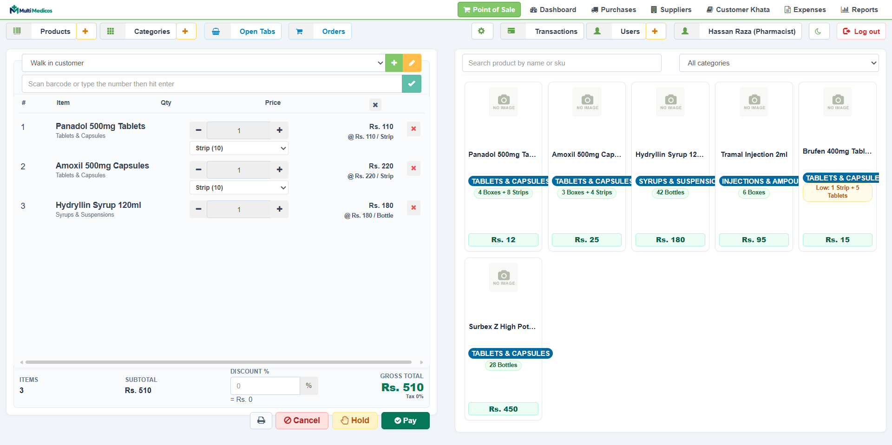

---

## Quick Summary (Roman Urdu)

> [!NOTE]
> **Multi Medicos** aik mukammal offline Windows desktop software hai jo Pakistani medical stores aur retail pharmacies ke liye banaya gaya hai. Yeh software bina internet ke chalta hai, Pakistani Rupee (PKR / Rs.) support karta hai, aur isme medicines ko Box, Strip (patta), aur loose Tablet/Capsule/Bottle me bechne aur khareedne ki poori suvidha mojood hai. Iske sath customer Udhaar / Khata ledger, distributors/suppliers ka hisab, expiry alert (FEFO), aur monthly Munafa (Profit & Loss) dashboard shamil hain.

---

## Table of Contents

- [About Multi Medicos](#about-multi-medicos)
- [Key Features](#key-features)
- [Screenshots Gallery](#screenshots-gallery)
- [Download & Installation (End Users)](#download--installation-end-users)
  - [System Requirements](#system-requirements)
  - [Installing the Application](#installing-the-application)
  - [Windows SmartScreen Notice](#windows-smartscreen-notice)
  - [First-Run Owner Setup](#first-run-owner-setup)
  - [Updating to Newer Versions](#updating-to-newer-versions)
- [Developer Getting Started](#developer-getting-started)
  - [Prerequisites](#prerequisites)
  - [Setup & Run](#setup--run)
  - [Running the Test Suites](#running-the-test-suites)
  - [Building the Windows Installer](#building-the-windows-installer)
  - [Troubleshooting Table](#troubleshooting-table)
- [First Day Guide for Shop Owners](#first-day-guide-for-shop-owners)
  - [Step-by-Step Walkthrough](#step-by-step-walkthrough)
  - [Verified Worked Example (Pack Math & Profit)](#verified-worked-example-pack-math--profit)
- [How Profit is Calculated](#how-profit-is-calculated)
- [Project Structure](#project-structure)
- [Architecture Overview](#architecture-overview)
- [Configuration & Data Persistence](#configuration--data-persistence)
- [Security & Access Control](#security--access-control)
- [Testing Summary](#testing-summary)
- [Contributing & Known Limitations](#contributing--known-limitations)
- [License, Credits & Maintainer](#license-credits--maintainer)

---

## About Multi Medicos

Multi Medicos is a fast, offline-first Windows desktop pharmacy management and point-of-sale system engineered specifically for Pakistani retail medical stores and pharmacies. 

Running a pharmacy in Pakistan presents unique operational realities:
- **Frequent internet outages:** The application must remain 100% operational offline without relying on remote cloud servers or external database daemons.
- **Pack sizes:** Medicines are purchased from distributors in boxes, but sold to customers in diverse packaging units: full boxes, blister strips (*patte*), or individual tablets and capsules.
- **Customer Khata (Udhaar):** Regular neighborhood customers frequently purchase on credit, requiring strict ledger tracking, credit limits, and balance statements.
- **Supplier terms & discounts:** Distributors invoice with line-item trade discounts and bonus packs that directly impact unit costs.
- **True profit accounting:** Cash flow from purchases is not the same as day-to-day profit; gross and net profit must be derived from the true Cost of Goods Sold (COGS) through First-Expiry-First-Out (FEFO) batch allocation.

Multi Medicos is a maintained, enterprise customization of the open-source [PharmaSpot](https://github.com/mhassan-ali/pharmacy-pos-desktop) project (MIT License). It preserves full upstream attribution while introducing a native SQLite storage engine (`node:sqlite` in WAL mode), pack size mechanics, double-entry financial journals, Pakistani Rupee (PKR / Rs.) formatting, dark mode styling, and executive reporting.

---

## Key Features

### 1. Point of Sale (POS)
- **Fast Product Search:** Instant lookup by barcode scan, medicine brand name, or SKU.
- **Multi-Unit Selling:** Sell the same medicine by Box, Strip, or individual Tablet/Capsule/Bottle/Ampoule with live automatic price calculation.
- **Flexible Billing:** Supports Cash, Credit (*Khata*), and Mixed payments (partial cash + balance added to customer ledger).
- **Line & Bill Discounts:** Apply percentage discounts with real-time bill recalculation.
- **Open Tabs / Held Orders:** Park active orders for hospital ward patients or returning customers and retrieve them anytime.
- **Thermal & A4 Receipts:** Instant receipt generation with store branding, item pack breakdowns, tax details, and custom footer messages.
- **Idempotency Protection:** Cryptographic transaction payload hashing prevents duplicate bill creation on network or printer lag.

### 2. Inventory & FEFO Batch Expiry
- **Batch Tracking:** Track batch numbers, manufacturing dates, and expiration dates for every received shipment.
- **FEFO Stock Allocation:** Automated First-Expiry-First-Out logic sells the nearest-expiring batch first to minimize expired waste.
- **Visual Expiry Badges:** Color-coded badges highlight active, near-expiry (< 60 days), and expired stock.
- **Low Stock & Reorder Alerts:** Configurable reorder thresholds per medicine with instant notifications.
- **Stock Valuation:** Real-time valuation of total on-hand inventory based on actual purchase costs.

### 3. Pack Size Mechanics (Box / Strip / Tablet)
- **Configurable Pack Hierarchy:** Define custom pack levels (e.g., 1 Box = 10 Strips = 100 Tablets; or 1 Box = 5 Ampoules).
- **Integer Precision Math:** Single-paisa exact integer cost allocation prevents rounding drift across partial packs.
- **Seamless Legacy Compatibility:** Products without pack configurations (e.g., standard syrup bottles, surgical items) continue to behave as single units without unwanted unit labels.

### 4. Customer Khata (Udhaar Ledger)
- **Customer Profiles:** Maintain customer contact numbers, delivery addresses, and maximum credit limits.
- **Receivables Tracking:** Real-time visibility of total customer receivables on the main dashboard.
- **Payment Collection:** Accept full or partial customer payments with automated ledger allocation.
- **Detailed Statements:** View chronological customer transaction and payment histories.

### 5. Suppliers & Purchase Invoicing
- **Distributor Management:** Maintain supplier catalogs, contact persons, payment terms, and phone numbers.
- **Purchase Receiving Workflow:** Draft purchases do not alter stock; marking an invoice as "Received" atomically updates aggregate inventory and batch balances.
- **Supplier Discounts & Bonus Items:** Enter supplier trade discounts (%) and bonus quantities; the system calculates the diluted unit cost per tablet automatically.
- **Live Cost Preview:** Displays `= 500 Tablets, cost PKR 7.60 per Tablet` in real time before finalizing the invoice.
- **Purchase Returns:** Return damaged or near-expiry batches to suppliers with automated inventory deduction.

### 6. Operating Expenses
- **Categorized Expenditures:** Track overhead costs including Shop Rent, Electricity (e.g., LESCO), Salaries, Refreshments, and Miscellaneous.
- **Cashbook Integration:** Automated synchronization between daily expense outflows and cash drawer balances.

### 7. Executive Dashboard & Financial Reports
- **12-Month Performance Visuals:** Multi-color monthly charts tracking Sales, Expenses, and Net Profit.
- **Report Center:** 
  - **Profit & Loss Statement:** True Net Sales minus COGS (on costed sales) minus Operating Expenses.
  - **Sales Report:** Itemized and cashier-wise revenue summaries.
  - **Expense Report:** Categorized overhead expenditure breakdowns.
  - **Stock Valuation:** Current inventory investment valuation.
  - **Expiry Report:** Advance warning list of near-expiry medicines.
  - **Top & Dead Stock:** Fast-moving vs stagnant inventory analysis.
  - **Payables & Khata Aging:** Aging buckets for outstanding debts.
  - **Daily Closing:** Cash in till reconciliation for shift handovers.

### 8. Security & User Management
- **Role-Based Access Control:** Configurable permissions for Products, Categories, Transactions, Users, and Settings.
- **Financial Privacy:** Cost prices, supplier invoices, and profit reports are restricted to authorized owners.
- **Credential Safety:** bcrypt password hashing (10 rounds); minimum 12-character password required for owner accounts.
- **Loopback Isolation:** The Express API binds exclusively to `127.0.0.1` and enforces strict origin validation.

### 9. Backup & Disaster Recovery
- **1-Click Backup:** Online SQLite backup engine creates verified `.zip` archives containing the database and uploaded logos with SHA-256 integrity checks.
- **Restart-Safe Staged Restore:** Validates backup archives in an isolated staging folder before replacing live data, automatically saving a safety backup copy (`PharmaSpot-before-restore-*`).

### 10. Modern Accessible Themes
- **High-Contrast Dark Theme:** Full dark mode complying with WCAG 2.1 AA accessibility standards for comfortable night-shift operation.
- **Strict Print Fidelity:** Receipts, invoices, and exported reports strictly preserve pure white backgrounds for clear thermal and laser printing.

---

## Screenshots Gallery

### Light Theme

| Point of Sale (POS) | Payment Dialog |
| :---: | :---: |
| <br><sub>Multi-unit cart, pack unit selector, category badges, and totals</sub> | 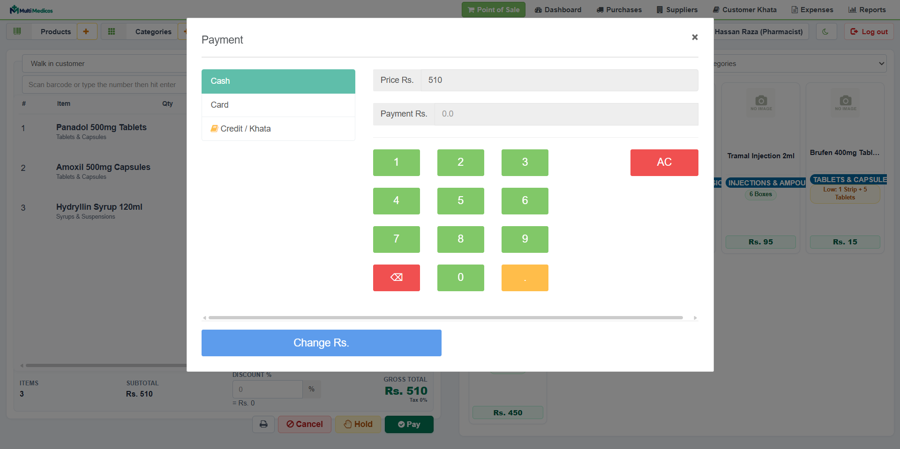<br><sub>Cash, Card, and Credit / Khata payment modal with change calculator</sub> |

| Executive Dashboard | Report Center (Profit & Loss) |
| :---: | :---: |
| 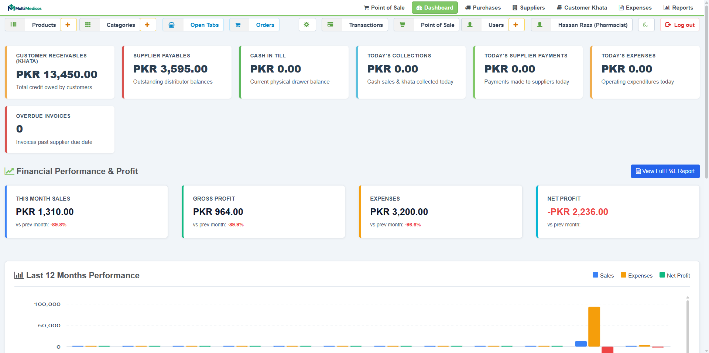<br><sub>Key financial metrics, receivables, payables, and 12-month performance chart</sub> | 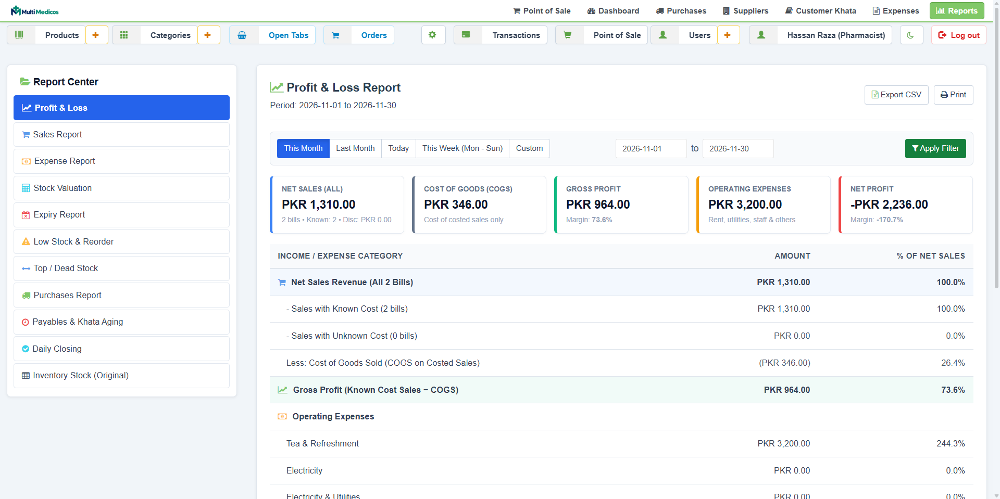<br><sub>True COGS-based gross profit, operating expenses, and net profit report</sub> |

| Product Catalog | Add / Edit Medicine Form |
| :---: | :---: |
| 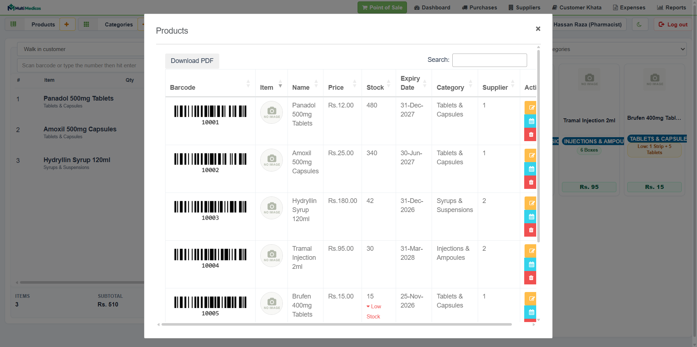<br><sub>Medicine catalog with barcode lookup, stock counts, and batch actions</sub> | 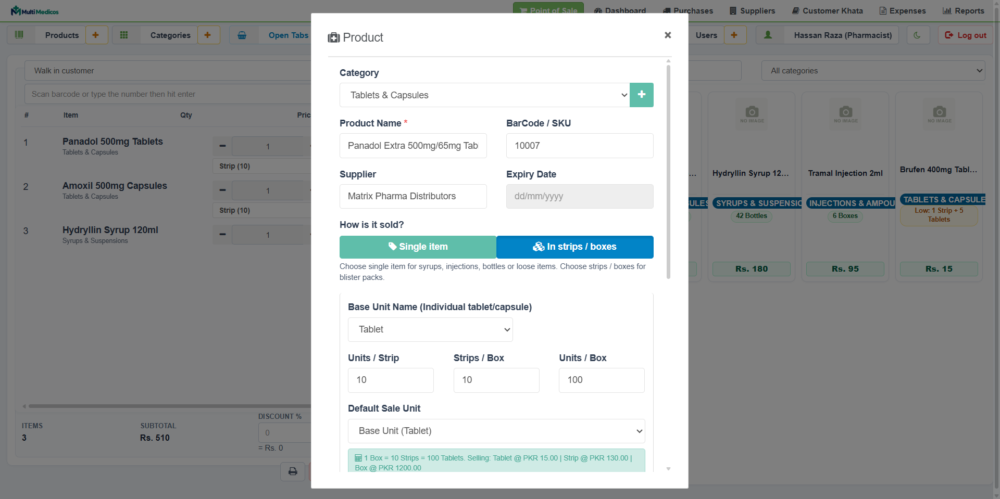<br><sub>Configurable pack packaging (Box, Strip, Tablet) with live price preview</sub> |

| New Medicine Purchase | Customer Khata (Udhaar) |
| :---: | :---: |
| 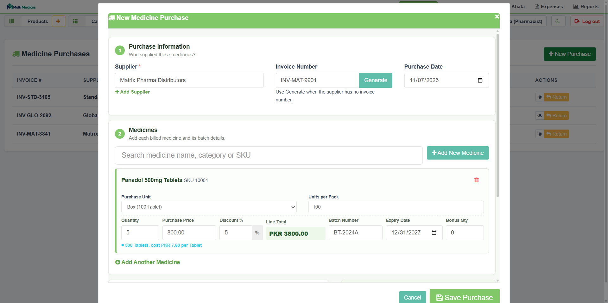<br><sub>Purchase entry with pack unit selection, trade discount %, and live unit cost preview</sub> | 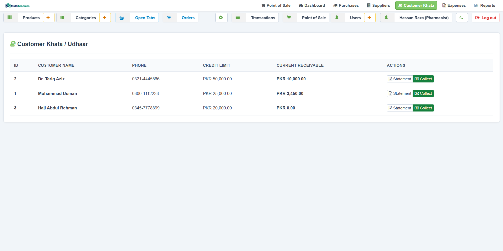<br><sub>Customer ledger with credit limits, current receivables, and statement actions</sub> |

| Supplier Management | Transaction History |
| :---: | :---: |
| 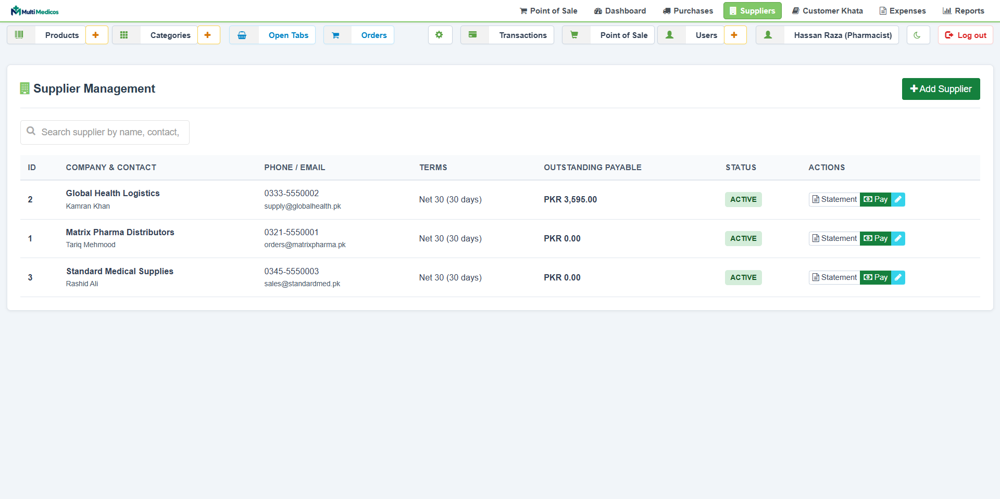<br><sub>Supplier directory with payment terms, contact info, and payables</sub> | 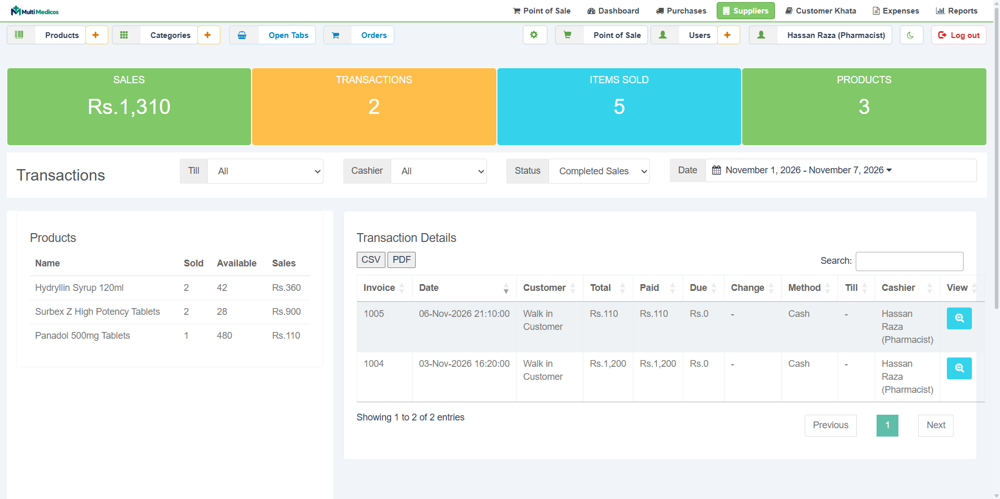<br><sub>Completed sales records with Cash, Khata, and Mixed status indicators</sub> |

| Printed Receipt Preview |
| :---: |
| 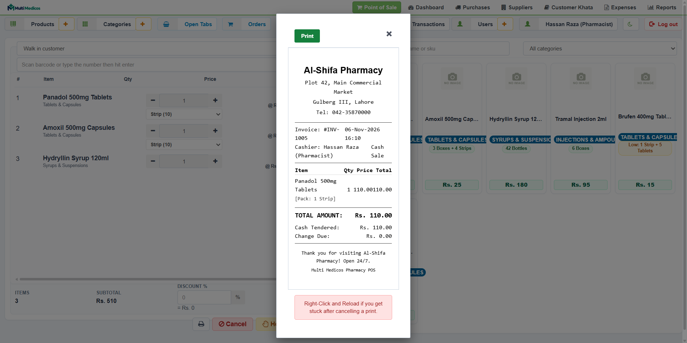<br><sub>Standard pharmacy receipt with store details, itemized pack sizes, and custom footer</sub> |

### Dark Theme

| Dark Point of Sale (POS) | Dark Executive Dashboard |
| :---: | :---: |
| 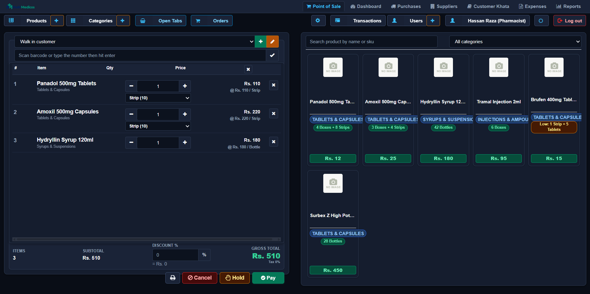<br><sub>High-contrast dark mode optimized for night shifts and reduced eye strain</sub> | 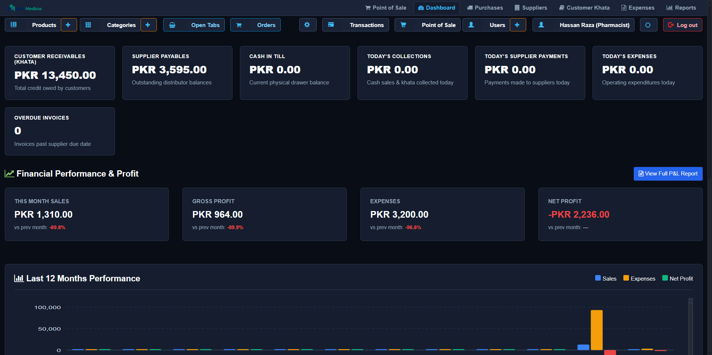<br><sub>Enterprise financial metrics and chart visualizer in dark theme</sub> |

---

## Download & Installation (End Users)

### System Requirements

- **Operating System:** Windows 10 or Windows 11 (64-bit).
- **Memory (RAM):** 4 GB minimum (8 GB recommended).
- **Disk Space:** Approximately 500 MB free disk space.
- **Dependencies:** **None.** End users do **not** need Node.js, Git, or Python. All required runtimes are bundled into the desktop executable.

### Installing the Application

1. Download the latest installer `Multi-Medicos-1.5.5-Setup.exe` from the official [GitHub Releases](https://github.com/mhassan-ali/pharmacy-pos-desktop/releases).
2. Double-click `Multi-Medicos-1.5.5-Setup.exe` to run the setup wizard.
3. Multi Medicos will install automatically and create a desktop shortcut.

### Windows SmartScreen Notice

> [!IMPORTANT]
> Because Multi Medicos is distributed as a community open-source binary without an expensive commercial code-signing certificate, Windows SmartScreen may show an **"Unknown Publisher"** or **"Windows protected your PC"** message on first launch.
>
> 1. Click **More info**.
> 2. Click **Run anyway**.
> 3. Verify that you obtained the setup file directly from the official release repository. Do not disable Windows Defender or system security.

### Data Storage Location

Multi Medicos stores all local databases, settings, and uploaded logos inside your Windows user profile:

```text
%APPDATA%\PharmaSpot\server\databases\pharmacy.sqlite
```

> [!NOTE]
> The internal folder path retains the name `PharmaSpot`. This is intentional: preserving the original application identifier allows new versions of Multi Medicos to automatically recognize and migrate existing pharmacy databases without data loss.

### First-Run Owner Setup

When launching Multi Medicos on a clean computer for the first time:

1. The application detects that no database exists and presents the **Create Owner Account** screen.
2. Enter your desired **Username** (e.g., `admin` or your name).
3. Enter a secure **Password** containing **at least 12 characters** (enforced by the authentication engine).
4. Click **Create Owner Account**.
5. Once logged in, open **Settings** (gear icon) to configure your pharmacy name, address, phone number, and receipt footer text.

### Updating to Newer Versions

> [!WARNING]
> **Database migrations are one-way.**
> When upgrading Multi Medicos, newer database schemas add columns and tables that older versions do not recognize.
> **Never downgrade to an older software version after using a newer one.**
>
> **Safe Upgrade Workflow:**
> 1. Open Multi Medicos and go to **File → Backup**. Save the backup file to a safe location (e.g., USB drive).
> 2. Close Multi Medicos completely.
> 3. Run the new installer `Multi-Medicos-<version>-Setup.exe`.
> 4. Launch Multi Medicos. Your existing medicines, stock, sales, and accounts will be automatically migrated.

---

## Developer Getting Started

Developers wishing to contribute or customize Multi Medicos can run the full source locally on Windows.

### Prerequisites

- **Operating System:** Windows 10 or 11 (x64).
- **Node.js:** Version **>= 24.x** (Node `v24.14+` or `v24.17+` recommended; required for native `node:sqlite`).
- **npm:** Version **>= 11.x** (bundled with Node 24).
- **Git:** Git for Windows.

Verify your installed versions in PowerShell:

```powershell
node -v
npm -v
git --version
```

### Setup & Run

Clone the repository and launch development mode:

```powershell
# 1. Clone the repository
git clone https://github.com/mhassan-ali/pharmacy-pos-desktop.git
Set-Location pharmacy-pos-desktop

# 2. Install dependencies reproducibly
npm ci

# 3. Start the application in development mode
npm start
```

`npm start` executes `electron-forge start`. The Electron main process (`start.js`) boots the loopback Express server (`server.js`) on port `3210` (or selects an available loopback port if busy), initializes the SQLite database, and opens the main desktop window.

### Running the Test Suites

All tests must run against isolated test directories without touching production databases:

```powershell
# Run Jest unit tests
npm test -- --runInBand

# Run core backend & business rule integration tests
node scripts/test-users.js
node scripts/test-sales.js
node scripts/test-sale-crash.js
node scripts/test-simple-supplier-purchase.js
node scripts/test-transaction-history.js
node scripts/test-enterprise-system.js
node scripts/test-offline-backup.js
node scripts/test-pending-restore.js

# Run pack sizes, purchase discount & profit verification tests
node scripts/test-pack-sizes.js
node scripts/test-task2-purchase-discount.js
node scripts/test-profit-and-reports.js
node scripts/test-contrast-audit.js

# Run end-to-end Electron UI test suites
node scripts/run-pack-sizes-ui-test.js
node scripts/run-supplier-purchase-ui-test.js
node scripts/run-transaction-ui-test.js
```

### Building the Windows Installer

To produce a production Squirrel.Windows setup package:

```powershell
npm run make:win
```

The output installer is compiled into:
```text
out/make/squirrel.windows/x64/Multi-Medicos-1.5.5-Setup.exe
```

### Troubleshooting Table

| Symptom / Error | Root Cause | Solution |
| :--- | :--- | :--- |
| `Cannot find module 'node:sqlite'` | Node version is older than 22/24. | Install **Node.js 24.x (64-bit)**. The backend requires the built-in `node:sqlite` DatabaseSync module. |
| `EADDRINUSE: address already in use` | Loopback port 3210 is reserved by another tool. | Multi Medicos will automatically fallback to a free port. You can also specify an explicit port: `$env:PORT=43210; npm start`. |
| Electron window does not open / hanging | Stray background Electron processes from previous crash. | Run `Stop-Process -Name electron -Force -ErrorAction SilentlyContinue` in PowerShell and re-run `npm start`. |
| Antivirus deletes `Setup.exe` during `make:win` | False positive on unsigned Squirrel installer files. | Whitelist the project `out/` build folder in Windows Defender or your antivirus suite. |
| Owner setup screen does not appear | Existing `%APPDATA%\PharmaSpot` database already exists. | The system found an existing database. If testing a clean run, set `$env:TEST_APPDATA="C:\temp\test-appdata"` before starting. |
| `EPERM` or `EBUSY` when copying database | Database file locked during WAL mode execution. | Do not copy raw `.sqlite` files while the app is running. Use **File → Backup** inside the app. |

---

## First Day Guide for Shop Owners

Setting up your pharmacy on Multi Medicos takes less than 15 minutes. Follow these practical steps:

### Step-by-Step Walkthrough

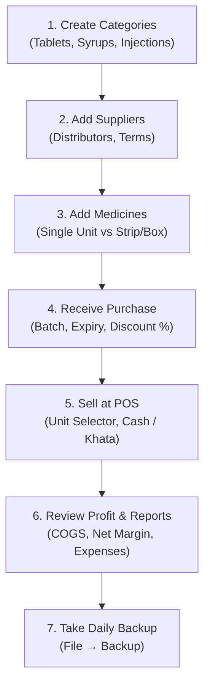

1. **Create Categories:** Go to **Categories (+)**. Add your core categories: *Tablets & Capsules*, *Syrups & Suspensions*, *Injections*, *Drops*, etc.
2. **Add Suppliers:** Go to **Suppliers → Add Supplier**. Enter your medicine distributors (e.g., Matrix Pharma, Global Health) and their payment terms (e.g., Net 30).
3. **Add Medicines:**
   - For syrups, eye drops, or creams: Choose **Single item**, pick the unit (Bottle, Tube), and set the retail price.
   - For blister packs (tablets/capsules): Choose **In strips / boxes**. Enter units per strip (e.g., 10), strips per box (e.g., 10), box price, strip price, and loose tablet price.
4. **Enter a Purchase:** Go to **Purchases → New Purchase**. Select the supplier, type the invoice number, search the medicine, choose the purchase unit (Box or Strip), quantity, purchase cost, supplier discount %, batch number, and expiry date. Click **Save Purchase** and mark it **Received** once physically verified.
5. **Make Sales at POS:** At **Point of Sale**, click or scan the medicine. For pack items, select whether you are selling 1 Box, 1 Strip, or loose Tablets. Select **Cash** or assign to a **Customer Khata**. Click **Pay** and print the receipt.
6. **Park Open Tabs:** If a customer needs to pick up more items or a doctor calls, click **Hold** to park the bill in **Open Tabs** without losing the cart.
7. **Record Daily Expenses:** Go to **Expenses → Add Expense** to record shop rent, electricity, staff tea, or cleaning supplies.
8. **Analyze Profit:** Open **Dashboard** and **Reports → Profit & Loss** to inspect your net sales, true Cost of Goods Sold, operating expenses, and net profit in Pakistani Rupees.
9. **Take a Daily Backup:** Before closing the shop, click **File → Backup** and save the archive to a USB flash drive.

---

### Verified Worked Example (Pack Math & Profit)

Here is a real-world calculation verified directly against the Multi Medicos calculation engine:

#### 1. Purchase Stage
- **Medicine:** Panadol 500mg Tablets (1 Box = 10 Strips = 100 Tablets).
- **Order Quantity:** 5 Boxes.
- **Supplier List Price:** PKR 800.00 per Box.
- **Supplier Trade Discount:** 5%.
- **Discounted Box Cost:** $\text{PKR } 800.00 \times (1 - 0.05) = \text{PKR } 760.00 \text{ per Box}$.
- **Total Invoice Cost:** $5 \times \text{PKR } 760.00 = \text{PKR } 3,800.00$.
- **Total Base Units Received:** $5 \times 100 = 500 \text{ Tablets}$.
- **True Cost per Tablet:** $\frac{\text{PKR } 3,800.00}{500} = \mathbf{\text{PKR } 7.60 \text{ per Tablet}}$.

#### 2. Point of Sale (POS) Stage
- A customer visits and asks for **1 Strip** (10 Tablets).
- **Selling Price for 1 Strip:** PKR 110.00.
- **Cost of Goods Sold (COGS):** $10 \text{ Tablets} \times \text{PKR } 7.60 = \mathbf{\text{PKR } 76.00}$.
- **Gross Profit on Sale:** $\text{PKR } 110.00 - \text{PKR } 76.00 = \mathbf{\text{PKR } 34.00}$.
- **Gross Margin:** $\frac{\text{PKR } 34.00}{\text{PKR } 110.00} = \mathbf{30.9\%}$.

Multi Medicos tracks this exact integer cost breakdown in the `sale_batch_cogs` table, guaranteeing that your Profit & Loss reports reflect your genuine margins down to the single paisa.

---

## How Profit is Calculated

Many basic POS programs mistake cash inflow for profit or treat inventory purchases as immediate expenses. Multi Medicos uses standard retail inventory accounting:

$$\mathbf{\text{Gross Profit}} = \text{Net Costed Sales} - \text{Cost of Goods Sold (COGS)}$$

$$\mathbf{\text{Net Profit}} = \text{Gross Profit} - \text{Operating Expenses}$$

### Key Accounting Rules:

1. **Purchases are NOT immediate expenses:**
   Buying PKR 50,000 worth of medicine does not mean you lost PKR 50,000 today. Purchasing inventory is an asset exchange: cash decreases, but inventory asset increases by the exact same value.
2. **COGS is recognized only when sold:**
   When a medicine is sold, its specific batch purchase cost is recognized as **Cost of Goods Sold (COGS)** via First-Expiry-First-Out (FEFO) allocation.
3. **Operating Expenses are deducted separately:**
   Expenses such as shop rent, electricity bills, staff salaries, and tea refreshments are deducted from Gross Profit to arrive at true **Net Profit**.
4. **Uncosted sales are protected:**
   If old legacy stock or items without purchase cost records are sold, Multi Medicos identifies them as *Sales with Unknown Cost* and excludes them from profit percentages so your margin is never artificially inflated.

---

## Project Structure

```text
pharmacy-pos-desktop/
├── api/                           # Backend Express API & SQLite Data Layer
│   ├── sqlite.js                  # node:sqlite connection, WAL mode & migrations
│   ├── pack-helpers.js            # Pure unit conversion & integer cost allocation
│   ├── inventory.js               # Products, barcodes, stock levels & batch FEFO
│   ├── purchases.js               # Supplier purchases, receiving & discount %
│   ├── transactions.js            # POS checkout, sales, items & idempotency
│   ├── reports.js                 # Report Center, P&L, valuation & movement
│   ├── ledger.js                  # Khata statements, collections & double-entry
│   ├── expenses.js                # Operating expense entries & categories
│   ├── customers.js               # Customer profiles & credit limits
│   ├── suppliers.js               # Supplier directory & contact management
│   ├── settings.js                # Pharmacy identity, currency & print options
│   └── users.js                   # Owner setup, bcrypt auth & role permissions
├── assets/                        # Frontend UI Resources
│   ├── css/
│   │   ├── enterprise.css         # Dashboard, Report Center, Purchase cards styling
│   │   └── dark-theme.css         # WCAG AA compliant dark theme variables
│   ├── js/
│   │   ├── pos.js                 # Cart operations, barcode scan, product modals
│   │   └── enterprise.js          # Dashboard charts, reports & purchase workflows
│   └── images/
│       └── multi-medicos.ico      # High-resolution application icon
├── docs/                          # In-Depth Documentation
│   ├── ARCHITECTURE.md            # Technical architectural flow & schemas
│   ├── DEVELOPER_SETUP.md         # Full developer instructions & test registry
│   ├── WINDOWS-INSTALLATION.md    # End-user setup & SmartScreen guide
│   ├── TROUBLESHOOTING.md         # Diagnostic solutions for common issues
│   └── RELEASE-NOTES-1.5.5.md     # Version 1.5.5 changelog & verified hashes
├── installers/                    # Installer & Lifecycle Handlers
│   ├── setupEvents.js             # Squirrel.Windows install/update event hooks
│   └── pendingRestore.js          # Safe staged restore execution on app startup
├── public/                        # Application static branding & logos
├── screenshots/                   # Real, verified demo screenshots
├── scripts/                       # Automated Verification & UI Test Runners
│   ├── capture-screenshots.js     # Headless demo seed & PNG capture automation
│   ├── test-pack-sizes.js         # Unit & integration checks for pack conversions
│   ├── test-profit-and-reports.js # Profit, COGS & report accuracy tests
│   ├── run-pack-sizes-ui-test.js  # End-to-end Electron UI pack test suite
│   └── test-contrast-audit.js     # WCAG AA contrast audit across all screens
├── tests/                         # Jest Unit Tests
│   └── utils.test.js              # Currency, date & stock math unit tests
├── index.html                     # Main desktop application interface & modals
├── start.js                       # Electron main process & window lifecycle
├── server.js                      # Loopback Express server startup (127.0.0.1)
├── forge.config.js                # Electron Forge packaging configuration
└── package.json                   # Dependencies, scripts & engine requirements
```

---

## Architecture Overview

Multi Medicos runs as a fully contained, local desktop process. It does not connect to external servers or transmit telemetry.

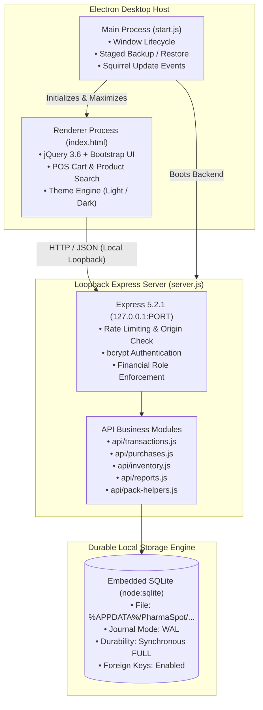

For complete technical details on database schemas, transaction rollback failpoints, and accounting journal lines, see [docs/ARCHITECTURE.md](docs/ARCHITECTURE.md).

---

## Configuration & Data Persistence

Multi Medicos is zero-configuration by default. The following environment variables can be used by developers and automated testing harnesses:

| Variable | Default Value | Purpose |
| :--- | :--- | :--- |
| `PORT` | `3210` | The loopback port for the local Express API. If occupied, a free port is chosen automatically. |
| `TEST_APPDATA` | *None* | Overrides the Windows `%APPDATA%` directory for testing. Allows parallel tests without touching live data. |
| `PHARMASPOT_DISABLE_RELOADER` | `0` | Set to `1` during automated headless tests to disable file-watcher reloads. |

### Database Files & Location
- **Live Database:** `%APPDATA%\PharmaSpot\server\databases\pharmacy.sqlite`
- **Write-Ahead Log:** `%APPDATA%\PharmaSpot\server\databases\pharmacy.sqlite-wal`
- **Uploaded Logos:** `%APPDATA%\PharmaSpot\uploads\`

### Backup File Format
In-app backups generated via **File → Backup** are `.zip` archives containing:
1. `pharmacy.sqlite`: An online database snapshot verified via SQLite integrity checks.
2. `uploads/`: Uploaded pharmacy receipt logos.
3. `manifest.json`: Metadata containing the application version, timestamp, and SHA-256 archive checksum.

---

## Security & Access Control

1. **Loopback Only:** The API binds exclusively to `127.0.0.1`. Remote machines on the same Wi-Fi or LAN cannot connect to the backend.
2. **CORS & Origin Filtering:** Requests without valid loopback origins are rejected (`403 Forbidden`).
3. **Password Hashing:** Passwords are never stored in plaintext. They are hashed using `bcrypt` (10 salt rounds).
4. **Session Tokens:** Successful login issues a cryptographic 256-bit token with automatic expiration.
5. **Granular Permissions:** Cashier accounts can be restricted from modifying products, editing categories, or viewing financial reports.
6. **Owner-Only Cost Privacy:** Routes exposing purchase costs and profit margins (`/api/reports/profit-loss`, `/api/reports/dashboard-profit`) enforce owner permissions (`requireFinancialPerm`).

---

## Testing Summary

Multi Medicos contains a comprehensive automated test suite covering unit math, integration rollback, persistence, and end-to-end Electron UI workflows:

```powershell
# Run the complete verification battery
npm test -- --runInBand
node scripts/test-pack-sizes.js
node scripts/test-task2-purchase-discount.js
node scripts/test-profit-and-reports.js
node scripts/test-enterprise-system.js
node scripts/test-offline-backup.js
node scripts/test-contrast-audit.js
node scripts/run-pack-sizes-ui-test.js
```

- **Unit Tests:** Verify days-to-expiry, stock status indicators, and currency formatting.
- **Pack Sizes Suite:** Validates all combinations of Box / Strip / Tablet conversions, integer cost distribution, and backward compatibility.
- **Purchase Discount Suite:** Tests supplier trade discount percentages, diluted unit costs, and bonus allocations.
- **Profit & Loss Suite:** Confirms that COGS is calculated strictly on costed sales and uncosted sales are segregated.
- **Crash & Rollback Suite (`test-sale-crash.js`):** Injects mid-transaction failures to guarantee atomic database rollback.
- **Contrast Audit Suite (`test-contrast-audit.js`):** Renders every modal and view in both light and dark themes to ensure WCAG 2.1 AA contrast compliance.

---

## Contributing & Known Limitations

Contributions, bug reports, and suggestions are welcome!

### Contributing Workflow
1. Check existing issues or open a new issue describing your feature or bug fix.
2. Create a feature branch:
   ```bash
   git switch -c feature/your-feature-name
   ```
3. Implement your changes. Maintain documentation integrity and adhere to existing coding styles.
4. Run all test suites: `npm test -- --runInBand` and relevant scripts in `scripts/`.
5. Open a Pull Request against `main`. See [CONTRIBUTING.md](CONTRIBUTING.md) for full guidelines.

### Known Limitations
- **Platform:** Multi Medicos is built specifically for 64-bit Windows desktop environments (Windows 10/11). Linux/macOS desktop builds are not officially supported.
- **Unsigned Installer:** The installer is currently unsigned. Users must click "More info → Run anyway" on Windows SmartScreen.
- **Single Barcode per Product:** Each product maps to one primary barcode / SKU. Alternative secondary barcodes for the same medicine require separate entries.
- **Historical Sales COGS:** Sales made on legacy versions before the addition of `sale_batch_cogs` lack batch purchase links and are treated as uncosted sales in profit statements.

---

## License, Credits & Maintainer

### License

Multi Medicos is released under the **MIT License**. See [LICENSE](LICENSE) for the full text.

### Upstream Attribution & Credits

- Multi Medicos is a substantial, maintained customization of the open-source **PharmaSpot** project created by **Nsubuga Derrick** (Copyright © 2023 Nsubuga Derrick).
- Upstream source architecture, core POS patterns, and MIT licensing are gratefully acknowledged.
- Desktop packaging powered by [Electron](https://www.electronjs.org/) and [Electron Forge](https://www.electronforge.io/).
- Icons provided by [Font Awesome](https://fontawesome.com/) and [Glyphicons](https://www.glyphicons.com/).

### Maintainer

**Muhammad Saad Saeed**  
GitHub: [@SAADSAEED007](https://github.com/SAADSAEED007)  
Project Repository: [pharmacy-pos-desktop](https://github.com/mhassan-ali/pharmacy-pos-desktop)
